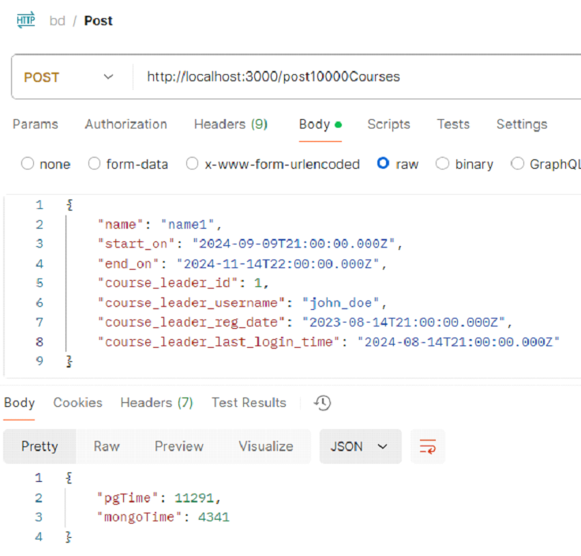
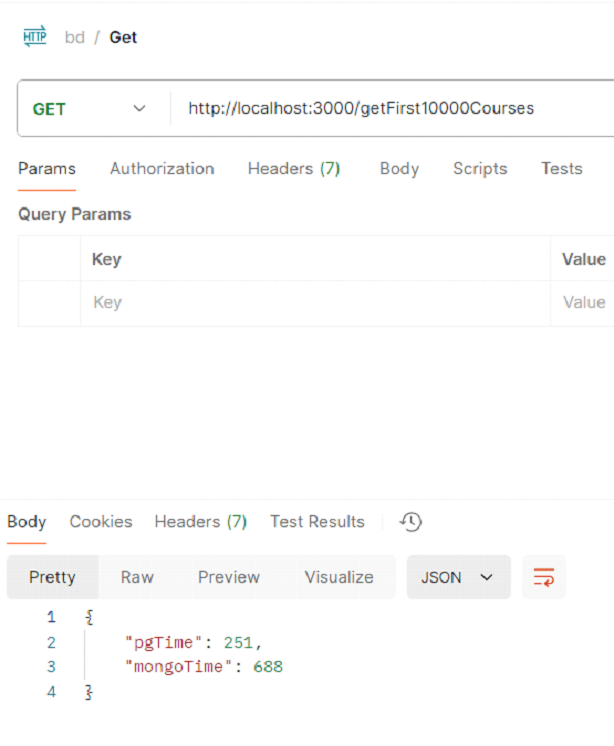
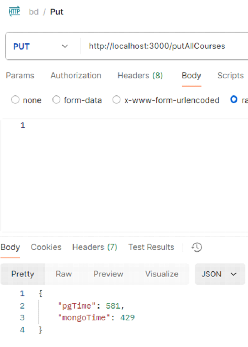

# 🗄️ SQL vs NoSQL: Performance Benchmark

> A Node.js benchmarking API comparing the execution speeds of PostgreSQL (Relational) and MongoDB (NoSQL) for bulk data operations. Developed as a laboratory project for the "Intelligent Systems" university course.

---

## 🎯 Project Overview
This project evaluates the performance differences between relational and non-relational databases under heavy loads. It tests the execution times for creating, fetching, and updating 10,000 records simultaneously, simulating a real-world scenario of a course management system.

The architecture utilizes a polyglot persistence approach to determine which database excels at specific tasks, transferring dynamic entity data (`coursesdetails`) into MongoDB while maintaining relational structures in PostgreSQL.

---

## 📊 Benchmark Results & Analysis

The API was tested using Postman to measure execution times in milliseconds (ms). 

### 1. Bulk Insert (POST 10,000 Courses)
MongoDB demonstrated a massive advantage in write speeds, executing **~62% faster** than PostgreSQL. This is due to its flexible document structure and the absence of complex relational `JOIN` validations during insertion.
*   **PostgreSQL:** 11,291 ms
*   **MongoDB:** 4,341 ms



### 2. Bulk Read (GET 10,000 Courses)
PostgreSQL significantly outperformed MongoDB during read operations, being **~173% faster**. This highlights PostgreSQL's powerful query optimization engine and advanced indexing capabilities for structured data retrieval.
*   **PostgreSQL:** 251 ms
*   **MongoDB:** 688 ms



### 3. Bulk Update (PUT All Courses)
MongoDB slightly edged out PostgreSQL in bulk document updates, executing **~26% faster**.
*   **PostgreSQL:** 581 ms
*   **MongoDB:** 429 ms



---

## 📂 Repository Structure
*   `courses_benchmark.js`: The main Express server containing the endpoints (`/post10000Courses`, `/getFirst10000Courses`, `/putAllCourses`) to run the benchmarks.
*   `data_migration.js`: A utility script that extracts relational data from PostgreSQL (using `JOIN` on `coursesdetails` and `usersinfo`) and migrates it into a unified MongoDB document collection.
*   `users_benchmark.js`: Initial benchmark script testing basic single-record CRUD operations for user profiles.
### Setup
1. Clone the repository and install dependencies:
   ```bash
   npm install express pg mongoose
